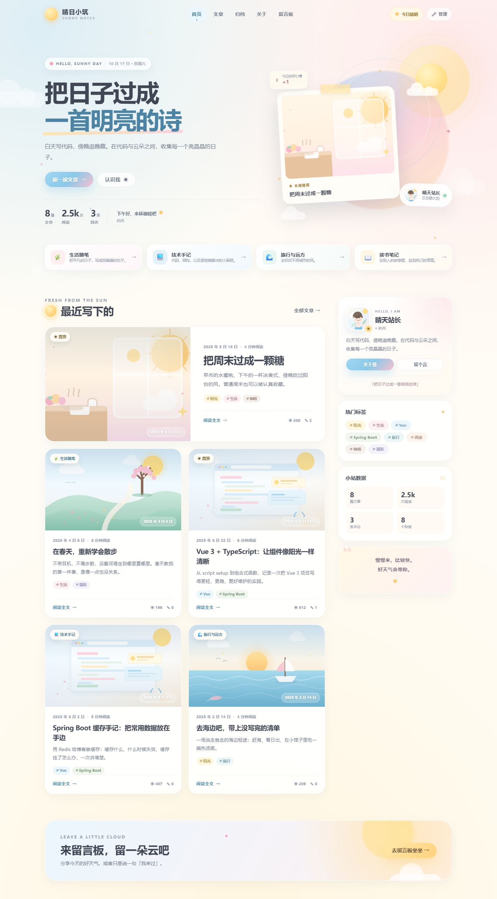
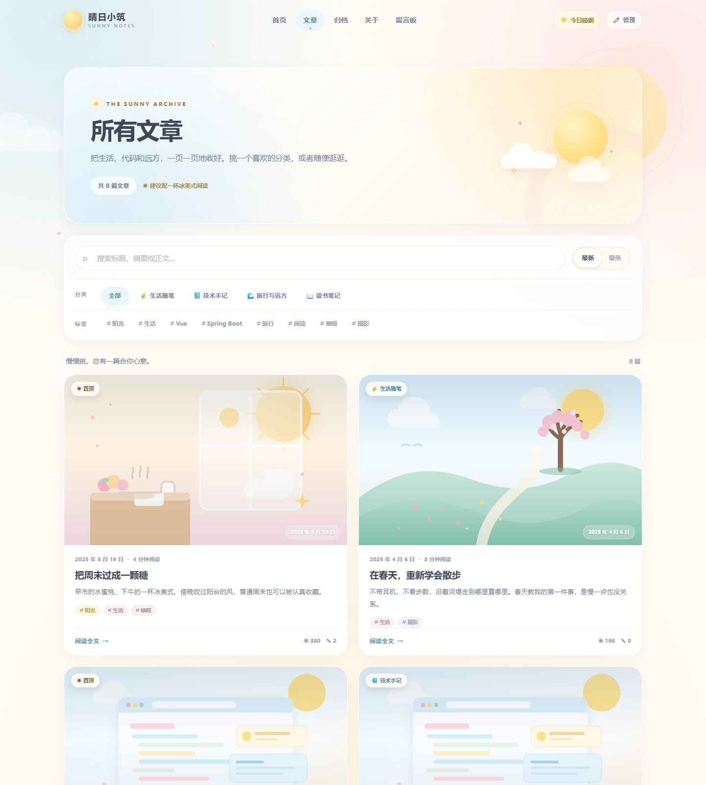
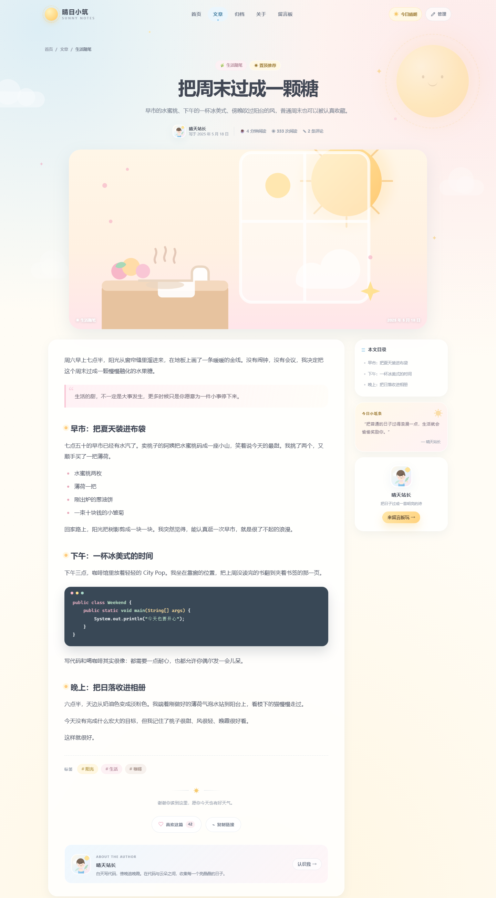
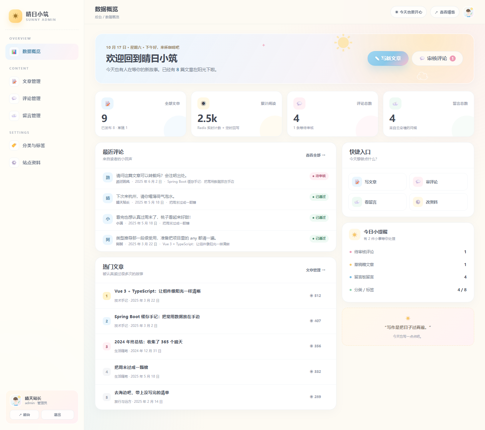
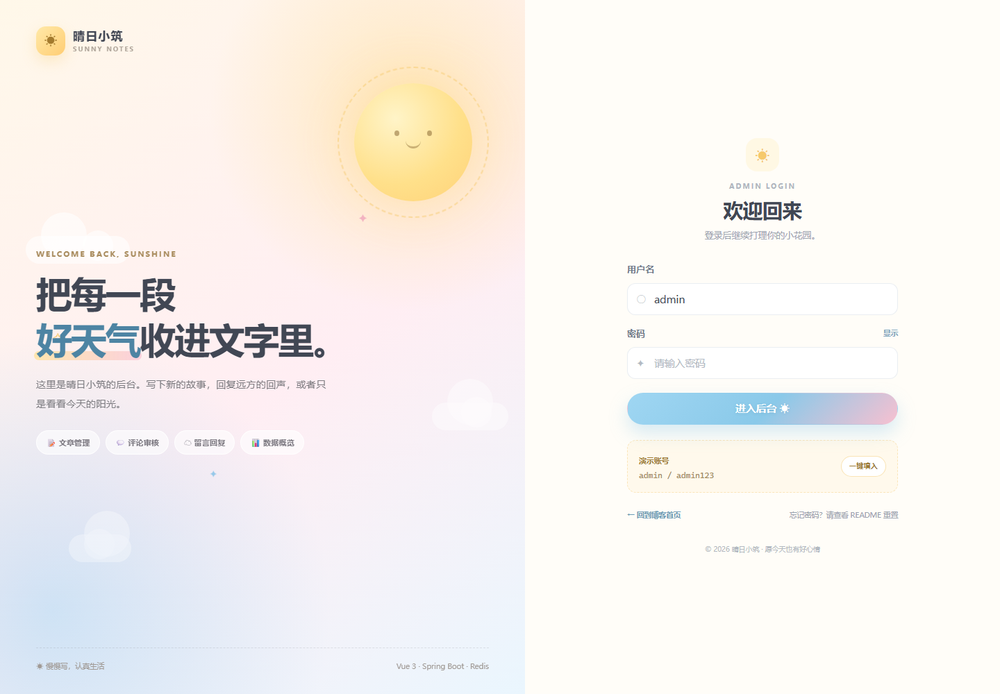
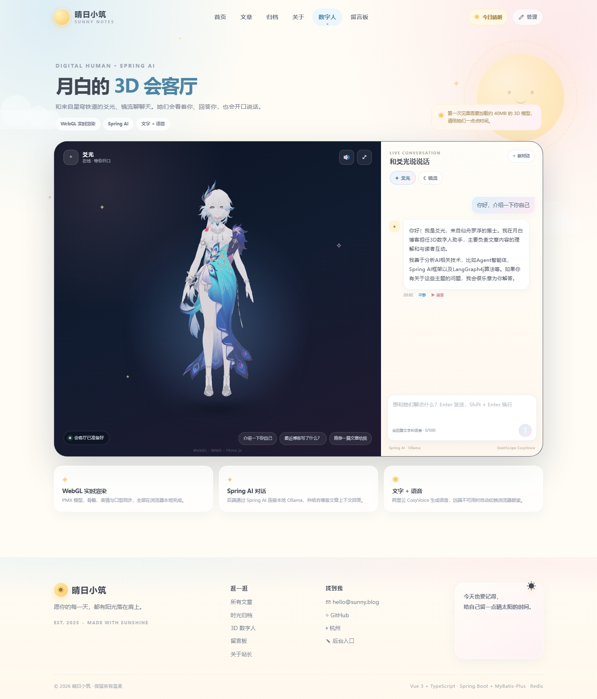
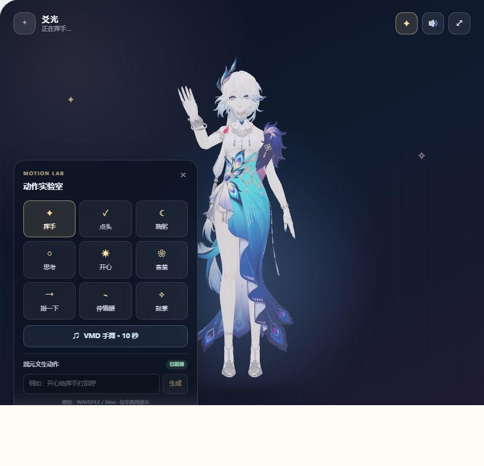
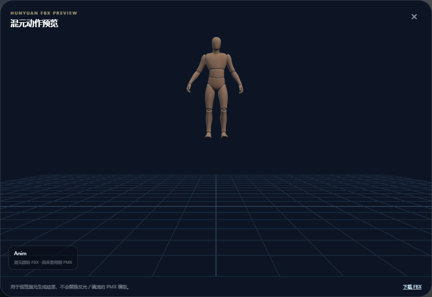
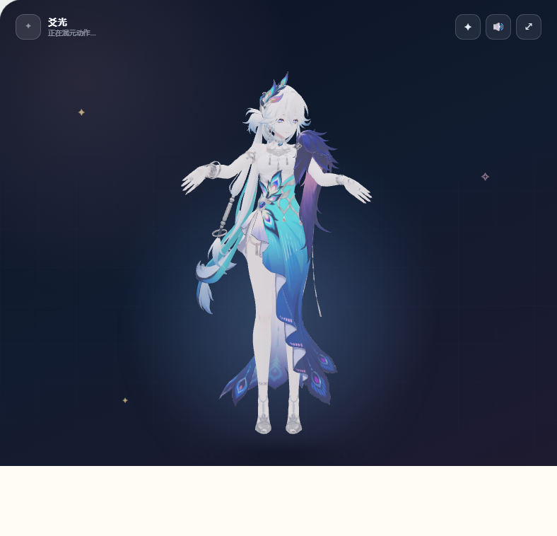

# 晴日小筑 · Sunny Blog

> 一个阳光明媚的个人博客。奶油白、淡蓝、淡粉，记录生活、代码、书与远方。
>
> 前后端分离：**Vue 3 + TypeScript** 前端，**Spring Boot + MyBatis-Plus** 后端，**Redis** 缓存，经典 **MVC** 分层。会客厅里还住着两位由 **Spring AI** 驱动、**WebGL** 实时渲染的 3D 数字人。
>
> 公开 GitHub 仓库不包含第三方 PMX 角色模型、贴图和本地下载的动作文件；请把它们放在 `frontend/public/models/` 与 `frontend/public/motions/local/` 下再运行（两个目录已加入 `.gitignore`）。



## ✨ 项目特色

- **阳光感视觉**：乳白底色、淡蓝与淡粉渐变、手绘感 SVG 封面、云朵与太阳装饰，桌面端与移动端都做了适配；文章封面和站点头像支持在后台直接上传本地图片。
- **完整前后台**：文章浏览、分类/标签筛选、搜索、归档、文章详情、评论、留言板、关于页；后台登录、数据概览、文章编辑、评论审核、留言回复、分类标签管理、站点资料维护。
- **3D 数字人会客厅**：`/digital-human` 页面用 Three.js + WebGL 渲染 PMX 模型（爻光 / 镜流），支持角色切换、表情、眨眼、口型同步、文字对话、语音播报、会话历史，以及「结合当前文章聊天」。
- **真正的缓存设计**：Redis 缓存文章详情、分类、标签、归档、站点资料和统计数据；文章阅读量先进入 Redis Hash，再定时批量回写数据库。
- **可降级**：Redis 不可用时缓存自动跳过、阅读量直接写库，不影响博客主流程。
- **零配置启动**：开发环境使用 H2 文件数据库（MySQL 兼容模式），不用安装 MySQL 也能直接跑；同时提供 MySQL 8 与 Docker Compose 方案。
- **JWT 后台认证**：BCrypt 密码、JWT 拦截器、Swagger 接口文档、统一响应与全局异常处理。

## 📸 页面预览

| 文章列表 | 文章详情 |
| --- | --- |
|  |  |

| 后台概览 | 登录页 |
| --- | --- |
|  |  |

| 3D 数字人会客厅 |
| --- |
|  |

| 动作实验室 |
| --- |
|  |

| 混元 FBX 预览 |
| --- |
|  |

| 混元动作重定向到 PMX |
| --- |
|  |

更多截图见 [`docs/screenshots`](docs/screenshots)。

## 🧱 技术栈

| 层 | 技术 |
| --- | --- |
| 前端 | Vue 3.5、TypeScript 5.6、Vite 5、Vue Router 4、Pinia 2、Axios、markdown-it、highlight.js、DOMPurify、Three.js 0.160 + MMDLoader |
| 后端 | Java 21、Spring Boot 3.3、Spring MVC、Validation、Spring Data Redis、Spring AI 1.0.0-M5、Springdoc OpenAPI、JJWT、BCrypt |
| AI / 语音 | Spring AI ChatClient + DeepSeek Flash（OpenAI 兼容接口）、阿里云 DashScope CosyVoice TTS、OkHttp WebSocket |
| 持久层 | MyBatis-Plus 3.5.9、H2（开发）/ MySQL 8（生产） |
| 缓存 | Redis 7（自定义版本化缓存 + 阅读量 Hash） |
| 工程 | Maven、npm、Docker Compose（可选） |

## 🗂 目录结构

```text
blog-deepseek/
├─ backend/                         # Spring Boot 后端
│  ├─ src/main/java/com/sunnyblog/
│  │  ├─ common/                    # 统一响应、分页、异常、工具
│  │  ├─ config/                    # MyBatis-Plus、CORS、JWT 拦截器、初始化
│  │  ├─ controller/                # 前台 + 后台 Controller
│  │  ├─ digitalhuman/              # 3D 数字人：Spring AI、会话、TTS、Controller
│  │  ├─ dto/                       # 请求 / 响应对象
│  │  ├─ entity/                    # 数据库实体
│  │  ├─ mapper/                    # MyBatis-Plus Mapper
│  │  ├─ security/                  # JWT 服务
│  │  └─ service/                   # Service 接口、实现、缓存、组装器
│  ├─ src/main/resources/
│  │  ├─ application.yml            # 公共配置
│  │  ├─ application-dev.yml        # H2 开发配置
│  │  ├─ application-mysql.yml      # MySQL 配置
│  │  ├─ db/schema-h2.sql           # H2 建表
│  │  └─ db/data-demo.sql           # 演示数据（H2 / MySQL 通用）
│  ├─ sql/schema-mysql.sql          # MySQL 建表
│  └─ pom.xml
├─ frontend/                        # Vue 3 + TypeScript 前端
│  ├─ public/
│  │  ├─ covers/                    # 手绘感 SVG 文章封面
│  │  ├─ models/                    # 数字人 PMX 模型与贴图（约 40MB）
│  │  ├─ motions/                   # VMD 动作模组与许可证说明
│  │  └─ images/avatar-yuebai.png   # 站长头像
│  └─ src/
│     ├─ api/                       # Axios 与类型定义
│     ├─ components/                # 公共组件、Markdown 编辑器、评论组件、FBX 预览
│     ├─ features/digital-human/    # Three.js 场景、MMD 加载、表情 / 口型 / 动作
│     ├─ layouts/                   # 前台布局、后台布局
│     ├─ router/                    # 路由与登录守卫
│     ├─ stores/                    # Pinia：认证、站点、Toast
│     ├─ styles/                    # 设计系统、Markdown、后台样式
│     ├─ utils/                     # 格式化、Markdown、常量
│     └─ views/                     # 前台页面 + admin 页面
├─ docs/screenshots/                # README 截图
├─ docker-compose.yml               # MySQL + Redis 基础设施
└─ scripts/                         # Windows 启动脚本
```

## 🚀 快速开始

### 0. 环境要求

- JDK **21**
- Maven **3.9+**
- Node.js **18+**（推荐 20/22）
- Redis **6+**（本机 `127.0.0.1:6379`，默认无密码）
- DeepSeek API Key（3D 数字人对话使用，模型 `deepseek-flash`）

```bash
java -version
mvn -v
node -v
redis-cli ping   # 返回 PONG 即可
```

DeepSeek Key 放在 `backend/application-local.yml` 的 `spring.ai.openai.api-key`，该文件已被 `.gitignore` 排除；也可以用环境变量 `DEEPSEEK_API_KEY`。

```bash
# 可选：不写本地配置文件时使用环境变量
$env:DEEPSEEK_API_KEY="你的 DeepSeek API Key"
```

### 1. 启动后端（开发模式，H2 + 本机 Redis）

```bash
cd backend
mvn spring-boot:run
```

后端地址：<http://127.0.0.1:8090>

- Swagger UI：<http://127.0.0.1:8090/swagger-ui.html>
- 健康检查：<http://127.0.0.1:8090/actuator/health>
- H2 控制台：<http://127.0.0.1:8090/h2-console>
  - JDBC URL：`jdbc:h2:file:./data/sunnyblog`
  - 用户名：`sa`，密码留空

首次启动会自动建表、写入演示文章/评论/留言/站点资料，并创建管理员账号。

### 2. 启动前端

```bash
cd frontend
npm install
npm run dev
```

打开 <http://127.0.0.1:5173>。Vite 已把 `/api` 代理到 `http://127.0.0.1:8090`。

### 3. 登录后台

- 地址：<http://127.0.0.1:5173/admin/login>
- 账号：`admin`
- 密码：`admin123`

> 生产环境务必通过环境变量修改默认账号与密码，并更换 JWT 密钥。

### 4. Windows 一键启动（可选）

```bat
scripts\start-all.cmd
```

会分别打开后端和前端两个命令行窗口；首次运行会自动构建/安装依赖。

## 🧑‍🚀 3D 数字人会客厅

打开 <http://127.0.0.1:5173/digital-human>，或者在导航栏点「数字人」。

### 它能做什么

- **Spring AI 对话**：后端通过 `ChatClient` 调用 DeepSeek Flash（OpenAI 兼容接口），默认模型 `deepseek-flash`；会话和历史消息落库，刷新页面仍可继续。
- **流式对话 + 动作先导**：每轮先让 LLM 选择动作/情绪，通过 SSE `meta` 事件下发，再流式输出文字；前端收到动作后立即播放，实现「先做动作，再边动边说」。
- **流式语音**：DeepSeek 的文字流到达后，后端立即开启一个 DashScope TTS 会话；后续文字通过 `continue-task` 追加，PCM 音频块边生成边通过 SSE `audio-pcm` 推送，前端用 Web Audio 连续排程播放。不是等整段回复合成完，也不是每句生成一个 WAV。
- **角色音色**：爻光使用 `longyingxiao_v3`，镜流使用 `longyingjing_v3`；音色保存在 `dh_character.tts_voice`，按角色切换。
- **WebGL 渲染**：Three.js `MMDLoader` 在浏览器里加载 PMX 模型，支持爻光 / 镜流切换、待机呼吸、眨眼、头部微动、情绪表情。
- **动作实验室**：9 个常用对话手势（正面挥手、敬礼、点头、鞠躬、思考、开心、害羞、伸懒腰、摊手），会随 AI 回复动作/情绪自动触发；另有一个 10 秒 VMD 手舞动作模组。动作分类参考了免费「エモート風モーション」套装的常见会话动作，未直接再分发第三方 VMD。
- **文字 + 语音**：回复先以文字气泡显示，再播放 DashScope CosyVoice 生成的 WAV；浏览器 `AudioContext` 分析音频能量，驱动 MMD 口型 morph 与说话时的小幅点头。
- **博客联动**：从文章详情页点击「和数字人聊聊这篇」，对话会自动带上文章上下文；普通对话也会注入最近文章标题与摘要。
- **降级策略**：DeepSeek 请求失败时返回可见的降级文字；TTS 失败时只保留文字，不再混用浏览器朗读，避免双声重叠。

### 动作实验室

舞台右上角的 `✦` 按钮打开动作面板：

- **程序化动作**：不依赖具体模型骨架，通过 MMD 标准骨（上半身、肩、腕、ひじ、首等）叠加关键帧，动作结束自动回到待机；挥手改为手掌朝向镜头、在脸侧前方挥动，思考是单纯低头，摊手是双臂向外展开、肩膀微耸，伸懒腰双手举过头顶。
- **情绪联动**：`happy → 开心`、`sad → 鞠躬`、`thinking → 思考`、`shy → 害羞`、`surprised → 伸懒腰`，其余回复会轻轻点头。
- **文字动作意图**：LLM 在回复开头先输出 `[[motion:key,emotion:tag]]`，后端边接收边解析出动作，再解析后续正文；长回复可以在段落间插入多个动作标签，前端按队列轮流播放，动作标签不会显示给用户。
- **说话时做动作**：动作不会在文字 meta 到达时提前播完，而是等第一条 PCM 语音真正开始播放时才触发，让挥手/思考/摊手发生在数字人说话的过程中；语音不可用时在文字完成时兜底。
- **待机与主动作**：本地 VMD 待机循环在挥手、思考、摊手等主动作开始时暂停，动作结束后按实际动作时长恢复，并用 0.9 秒姿势混合避免僵硬跳变；对话说话时继续保留待机呼吸和点头。
- **VMD 手舞**：加载 `public/motions/wavefile_v2.vmd`，只保留上半身骨骼，移除根骨位移、腿部轨道；给骨盆叠加小幅左右/前后摆动，同时反向旋转大腿并锁住脚踝，让屁股有轻微律动，双脚始终站在原地。
- **混元文生动作**：配置 Key 后提交提示词，任务完成会返回 FBX 下载地址，并可在页面内预览混元生成的原始骨骼动画。点击「套用到角色」会通过 `SkeletonUtils.retargetClip` 把 SMPL 骨骼重定向到当前 PMX 骨骼，直接驱动爻光 / 镜流；复杂动作通过动作实验室手动生成。**骨盆、腿和脚不参与重定向**，角色固定在舞台中心，只驱动脊柱、头和手臂。

> VMD 手舞模组来自 Three.js r160 示例资源，原作为 **WAVEFILE / hino**，使用条件见 `frontend/public/motions/wavefile_v2_readme.txt` 与 `LICENSE-three-mmd.txt`：允许改変与再配布，**禁止未告知的商业利用**，本项目仅作个人非商业展示。
>
> 对话动作分类参考了 BOOTH 免费发布的 [エモート風モーション（VMDファイル）](https://booth.pm/ja/items/5321972)（お辞儀、敬礼、手を振る、拍手、声援等）。该资源下载需要 BOOTH 登录，本项目没有绕过登录或再分发文件；本地导入的 VMD 与程序化动作混合使用。

### 可选的整套对话动作包

推荐 **射当ユウキ / プリメロ工房「エモート風モーション」**：
[BOOTH 免费下载页](https://booth.pm/ja/items/5321972)

- 235 KB ZIP，14 个 VMD，首尾姿势一致，可无缝循环
- 打招呼：お辞儀、敬礼、手を振る、土下座
- 鼓舞：レッツゴー、手拍子、声援、拍手
- 表达：ろくろを回す、寂しがる、手招き、注意喚起、落ち着かせる、揉み手
- 授权允许嵌入游戏/软件，但需在说明或 staff roll 标注作者 **射当ユウキ**；修改后转换/再分发需附带原作者与 BOOTH 来源
- BOOTH 免费下载仍要求登录；没有登录态无法直接抓取 ZIP

已接入本地的动作（`frontend/public/motions/local/gestures/`，不提交）：

- `wave.vmd` ← 手を振る
- `salute.vmd` ← 敬礼
- `bow.vmd` ← お辞儀
- `think.vmd` ← 腕組みIA モーション＋（抱臂思考）
- `rubhands.vmd` ← 揉み手（害羞）
- `stretch.vmd` ← 伸びモーション（作者：翡水 / @jade_itrv）
- 开心继续使用程序化拍手动作：`clap.vmd` 的手臂绑定与当前模型不兼容，强行播放会扭曲
- 动作包作者：**射当ユウキ / プリメロ工房**；软件内使用需保留作者 credit，详细条款见本地 `License_Emote.txt`
- 动作包原始 14 个 VMD 中的 12 个保留在 `frontend/public/motions/local/gestures/`：`bow`、`salute`、`wave`、`cheer`、`letsgo`、`handclap`、`spin`、`warn`、`calm`、`lonely`、`beckon`、`rubhands`；`dogeza`（土下座）和 `clap`（拍手）已移除
- 动作面板「动作包 · 12」区域可逐个预览/播放
- 动作 VMD 会过滤头部/颈部轨道：动作包来自其他骨架模型，直接套用头部骨骼会让爻光突然低头遮住脸；现在头部保持当前朝向，身体动作照常播放
- 12 个动作都带程序化表情：鞠躬→害羞、敬礼/挥手/打拍子/招手→开心、声援/出发→兴奋、转手→思考、提醒→惊讶、安抚→平静、寂寞→难过、搓手→害羞；动作结束恢复原表情

「摊手」暂未找到合适的原生 VMD，继续使用程序化双臂展开。可选的接近单动作：[机でため息モーション](https://bowlroll.net/file/351079)；BowlRoll 下载需要登录或权限。

待机动作参考了这些公开的站立/待机资源：
[自然な立ち待機モーション（VRMA）](https://booth.pm/ja/items/8815790)、
[Stand&Cam 立ちポーズ集](https://booth.pm/ja/items/5482433)、
[BowlRoll · MMD原神立ちっぱなしアニメーション](https://bowlroll.net/file/291442)。
它们的下载分别需要 BOOTH 登录或 BowlRoll 下载权限，因此项目没有直接打包这些文件，而是在 `MotionEngine` 中实现了程序化版本：持续重心摆动、看四周、手部小动作、整理袖口等，避免对话时身体僵住。

本地已可选接入下载好的 VMD 待机动作：

- `frontend/public/motions/local/genshin-idle.vmd`：**Hotaru7MMD · Lumine Idle Cycle**
- `frontend/public/motions/local/stand-p01.vmd`：**かんな@MMD · Stand&Cam Vol.1 P01**
- 两个文件及 `action/` 目录都在 `.gitignore` 中，不随仓库分发
- 使用条件：需要保留作者 credit，禁止再分发原始/修改后的动作文件；当前仅用于本机个人展示
- 文件缺失时前端自动回退到程序的待机微动作

### 混元文生动作配置

```powershell
$env:HUNYUAN_MOTION_API_KEY="你的 TokenHub API Key"
$env:HUNYUAN_MOTION_MODEL="hy-3d-motion"
```

TokenHub 接口：

```text
POST https://tokenhub.tencentmaas.com/v1/api/3d/submit
POST https://tokenhub.tencentmaas.com/v1/api/3d/query
```

后端会以 `Authorization: Bearer <Key>` 调用，把生成的 FBX 保存到 `backend/data/digital-human/motions`，并通过 `/api/digital-human/motions/{file}` 提供下载。动作面板的「预览」按钮会用 `FBXLoader` 在弹窗中播放混元原始骨骼动画。

> 本机 Key 写入 `backend/application-local.yml`（该文件在 `.gitignore` 中），不要提交到仓库；如果 Key 曾经出现在聊天/截图中，建议在控制台轮换一次。

### 配置

`application.yml` 中的默认值：

```yaml
spring:
  ai:
    openai:
      api-key: ${DEEPSEEK_API_KEY:}
      base-url: https://api.deepseek.com
      chat:
        options:
          model: deepseek-flash
          temperature: 0.7

aliyun:
  tts:
    api-key: ${ALIYUN_TTS_API_KEY:}
    model: cosyvoice-v3-flash
    voice: longyingxiao_v3
    sample-rate: 24000

hunyuan:
  motion:
    api-key: ${HUNYUAN_MOTION_API_KEY:}
    base-url: https://tokenhub.tencentmaas.com
    model: hy-3d-motion
```

本机密钥放在 `backend/application-local.yml`（已 gitignore），或通过环境变量注入：

```powershell
$env:DEEPSEEK_API_KEY="你的 DeepSeek Key"
$env:ALIYUN_TTS_API_KEY="你的 DashScope Key"
$env:HUNYUAN_MOTION_API_KEY="你的混元 TokenHub Key"
```

> 语音是可选增强。没有配置 TTS Key 时，文字对话和 3D 渲染仍正常工作，只是不播放语音；不会再用浏览器朗读混入角色声音。

### 模型资源

`frontend/public/models` 中的 PMX 与贴图来自用户提供的 3D 数字人项目，首次进入页面会加载约 40MB。模型路径由 `dh_character` 表维护；新增角色时把模型目录放进 `frontend/public/models`，再插入一条角色记录即可。

`frontend/public/motions/wavefile_v2.vmd` 是 VMD 动作模组，同目录附有原始 readme 与许可证说明。混元生成的 FBX 会保存在 `backend/data/digital-human/motions`（已 gitignore），不进入仓库。

### 相关接口

```text
GET    /api/digital-human/characters      角色列表
POST   /api/digital-human/sessions        创建会话
GET    /api/digital-human/sessions/{id}   会话与历史
DELETE /api/digital-human/sessions/{id}   结束会话
POST   /api/digital-human/chat            对话（SSE：meta / motion / delta / audio-pcm / done）
POST   /api/digital-human/chat/stream     同上，显式流式别名
POST   /api/digital-human/tts             单独合成一句 WAV（手动/降级用）
GET    /api/digital-human/status          引擎状态
GET    /api/digital-human/audio/{file}    播放 TTS WAV
GET    /api/digital-human/motions/hunyuan/status   混元动作配置状态
POST   /api/digital-human/motions/hunyuan          提交混元文生动作任务
GET    /api/digital-human/motions/hunyuan/{id}     查询任务并下载 FBX
GET    /api/digital-human/motions/{file}           访问已生成 FBX
```

## 🐬 使用 MySQL

### 当前环境：本机 MySQL 快捷启动

本机 MySQL 的连接信息写在 `backend/application-local.yml`（该文件已在 `.gitignore` 中排除，不会提交），后端会以 `local` profile 启动：

```bat
scripts\start-backend-mysql.cmd
```

或者同时启动前后端：

```bat
scripts\start-all-mysql.cmd
```

当前使用的数据库为 `sunny_blog`，表结构和演示数据已经导入。若换机器或换密码，只需修改 `backend/application-local.yml`。

### 方式 A：Docker Compose（推荐）

```bash
docker compose up -d
```

会启动：

- MySQL 8：`127.0.0.1:3307`，数据库 `sunny_blog`，用户 `sunny / sunnyblog123`
- Redis 7：`127.0.0.1:6380`，密码 `sunnyblog123`

首次启动自动执行 `backend/sql/schema-mysql.sql` 和演示数据。

然后用 MySQL 配置启动后端（PowerShell）：

```powershell
cd backend
$env:DB_PORT="3307"
$env:DB_USER="sunny"
$env:DB_PASSWORD="sunnyblog123"
$env:REDIS_PORT="6380"
$env:REDIS_PASSWORD="sunnyblog123"
mvn spring-boot:run "-Dspring-boot.run.profiles=mysql"
```

### 方式 B：本机 MySQL 8

```bash
mysql -u root -p < backend/sql/schema-mysql.sql
mysql -u root -p sunny_blog < backend/src/main/resources/db/data-demo.sql
```

```powershell
cd backend
$env:DB_HOST="127.0.0.1"
$env:DB_PORT="3306"
$env:DB_NAME="sunny_blog"
$env:DB_USER="root"
$env:DB_PASSWORD="你的密码"
mvn spring-boot:run "-Dspring-boot.run.profiles=mysql"
```

> `application-mysql.yml` 默认连接 `127.0.0.1:3306/sunny_blog`。生产环境请使用独立账号，不要使用 root。

## ⚙️ 配置项

| 环境变量 | 默认值 | 说明 |
| --- | --- | --- |
| `SERVER_PORT` | `8090` | 后端端口 |
| `SPRING_PROFILES_ACTIVE` | `dev` | `dev` / `mysql` / `docker` |
| `REDIS_HOST` | `127.0.0.1` | Redis 地址 |
| `REDIS_PORT` | `6379` | Redis 端口 |
| `REDIS_PASSWORD` | 空 | Redis 密码 |
| `REDIS_DATABASE` | `0` | Redis 库 |
| `DB_HOST` | `127.0.0.1` | MySQL 地址（mysql profile） |
| `DB_PORT` | `3306` | MySQL 端口 |
| `DB_NAME` | `sunny_blog` | 数据库名 |
| `DB_USER` | `root` | 数据库用户 |
| `DB_PASSWORD` | `root` | 数据库密码 |
| `JWT_SECRET` | 开发默认值 | JWT 签名密钥，生产必须更换 |
| `JWT_EXPIRE_HOURS` | `168` | Token 有效期（小时） |
| `ADMIN_USERNAME` | `admin` | 首次启动创建的管理员用户名 |
| `ADMIN_PASSWORD` | `admin123` | 首次启动创建的管理员密码 |
| `ADMIN_NICKNAME` | `月白` | 管理员昵称 |
| `CORS_ALLOWED_ORIGINS` | `http://localhost:5173,http://127.0.0.1:5173` | 允许的前端来源 |
| `DEEPSEEK_API_KEY` | 空 | DeepSeek API Key（数字人对话） |
| `DEEPSEEK_BASE_URL` | `https://api.deepseek.com` | DeepSeek OpenAI 兼容接口地址 |
| `DEEPSEEK_MODEL` | `deepseek-flash` | 数字人对话模型 |
| `DEEPSEEK_TEMPERATURE` | `0.7` | 对话温度 |
| `ALIYUN_TTS_API_KEY` | 空 | DashScope CosyVoice Key（可选） |
| `DIGITAL_HUMAN_AUDIO_DIR` | `./data/digital-human/audio` | TTS WAV 存放目录 |
| `DIGITAL_HUMAN_MOTION_DIR` | `./data/digital-human/motions` | 混元 FBX 存放目录 |
| `HUNYUAN_MOTION_API_KEY` | 空 | 混元 TokenHub API Key（待配置） |
| `HUNYUAN_MOTION_MODEL` | `hy-3d-motion` | 混元文生动作模型 |

> 管理员账号只会在数据库中不存在时创建；修改 `ADMIN_PASSWORD` 不会覆盖已有密码。

## 🔌 API 一览

统一响应格式：

```json
{ "code": 0, "message": "ok", "data": {} }
```

| 方法 | 路径 | 说明 |
| --- | --- | --- |
| GET | `/api/posts` | 文章分页（`page`、`size`、`category`、`tag`、`keyword`、`sort`） |
| GET | `/api/posts/latest` | 最新文章 |
| GET | `/api/posts/featured` | 置顶推荐 |
| GET | `/api/posts/{slug}` | 文章详情 |
| GET | `/api/posts/archive` | 归档 |
| POST | `/api/posts/{slug}/view` | 记录阅读量（Redis） |
| POST | `/api/posts/{slug}/like` | 点赞 |
| GET | `/api/posts/{slug}/comments` | 已通过审核的评论 |
| POST | `/api/posts/{slug}/comments` | 发表评论（待审核） |
| GET | `/api/categories` / `/api/tags` | 分类 / 标签 |
| GET | `/api/site` / `/api/stats` | 站点资料 / 统计 |
| GET/POST | `/api/guestbook` | 留言列表 / 留言 |
| GET | `/api/digital-human/characters` | 数字人角色列表 |
| POST | `/api/digital-human/sessions` | 创建数字人会话 |
| GET/DELETE | `/api/digital-human/sessions/{id}` | 读取 / 结束会话 |
| POST | `/api/digital-human/chat` | 数字人对话（SSE：文字 + PCM 流式语音） |
| GET | `/api/digital-human/status` | Spring AI / TTS / WebGL 状态 |
| POST | `/api/admin/auth/login` | 管理员登录 |
| GET | `/api/admin/auth/me` | 当前管理员 |
| GET | `/api/admin/dashboard` | 后台概览 |
| GET/POST/PUT/DELETE | `/api/admin/posts...` | 文章管理 |
| PATCH | `/api/admin/posts/{id}/status` | 发布 / 撤回 |
| GET/PATCH/DELETE | `/api/admin/comments...` | 评论审核 / 删除 |
| GET/PATCH/PUT/DELETE | `/api/admin/guestbook...` | 留言审核 / 回复 / 删除 |
| GET/POST/PUT/DELETE | `/api/admin/categories...` | 分类管理 |
| GET/POST/PUT/DELETE | `/api/admin/tags...` | 标签管理 |
| GET/PUT | `/api/admin/site` | 站点资料维护 |
| POST | `/api/admin/uploads/image` | 上传文章封面 / 站点头像（multipart，≤5MB） |

完整参数与在线调试见 Swagger：<http://127.0.0.1:8090/swagger-ui.html>

## 🧊 Redis 缓存设计

### 1. 版本化缓存

缓存 key 形如：

```text
sunnyblog:postDetail:<version>:weekend-candy
```

- 每个命名空间有一个版本号 `sunnyblog:ver:<namespace>`；
- 数据变更时只递增版本号，旧缓存自然过期，避免 `KEYS` / `SCAN` 清理；
- 命名空间：`postDetail`、`categories`、`tags`、`archive`、`site`、`stats`；
- 文章详情 TTL 10 分钟，站点资料 30 分钟，分类/标签 2 小时，归档 10 分钟，统计 5 分钟。

### 2. 阅读量

- `POST /api/posts/{slug}/view` 先写 Redis Hash `sunnyblog:views:pending`；
- 后台每 60 秒批量回写数据库，并在关闭应用时再刷一次；
- Redis 不可用时直接更新数据库；
- 文章详情返回的阅读量 = 数据库值 + Redis 待回写增量。

### 3. 降级

所有缓存读写都捕获异常并记录日志，失败时自动回源数据库；缓存是加速器，数据库始终是最终数据源。

## 🗄 数据表

| 表 | 说明 |
| --- | --- |
| `blog_user` | 后台管理员 |
| `blog_post` | 文章（Markdown 正文、状态、置顶、阅读/点赞/评论数） |
| `blog_category` | 分类 |
| `blog_tag` | 标签 |
| `blog_post_tag` | 文章-标签关联 |
| `blog_comment` | 文章评论（待审核/通过/拒绝） |
| `blog_guestbook` | 留言板（含站长回复） |
| `blog_site_profile` | 站点资料、关于页 Markdown、页脚 |
| `dh_character` | 数字人角色、系统提示词、TTS 音色、PMX 模型路径 |
| `dh_session` | 数字人会话（关联角色、状态） |
| `dh_message` | 数字人消息（用户 / 助手、情绪、语音 URL） |

## 🧪 构建与验证

```bash
# 后端
cd backend
mvn -DskipTests package

# 前端
cd frontend
npm run typecheck
npm run build
```

已完成的验证：

- 后端 `mvn package` 构建通过；
- Spring AI `ChatClient` 与 **DeepSeek Flash** 联调通过，SSE 流式中文回复与动作选择正常；
- 数字人 TTS 联调通过：DashScope 返回 PCM 流，按角色音色连续合成；
- `/chat` 已改为 SSE：文字先完成，`audio-pcm` 音频块继续推送并直接播放；
- 动作实验室：9 个手势、情绪联动、LLM 流式动作标签、多动作队列、VMD 上半身手舞播放/停止均通过浏览器验证，无控制台错误；
- 动作表现已校正：正面挥手手掌朝向镜头、思考单纯低头、摊手双臂展开、伸懒腰双手过顶；
- 下盘策略：VMD 移除腿/根骨轨道，骨盆跟随上半身做小幅律动，双腿用两骨 IK 锁脚，脚踝世界坐标偏移小于 1mm；混元 FBX 只重定向脊柱/头/手臂，骨盆和腿保持待机，角色固定在舞台中心；
- SSE 流式对话验证通过：`meta` 动作先于 `delta` 文字到达；「挥手」会先触发动作再流式输出；
- 混元 HY-3D-Motion 已真实联调：提交任务、轮询完成、下载 16.9MB FBX、页面内 FBX 预览均通过；
- 混元 FBX 已完成 PMX 骨骼重定向验证：Tai Chi 任务生成后直接驱动爻光播放 9.7 秒；
- 流式 PCM 语音验证通过：单次 TTS 会话追加文本，音频块持续到达；无浏览器朗读混入；
- 浏览器 WebGL2 渲染验证通过：爻光 / 镜流 PMX 均可加载，角色切换与页面无控制台错误；
- 17 项 API 集成检查通过：站点资料、分类、分页、标签筛选、文章详情、Redis 阅读量、管理员登录、鉴权拦截、评论审核、文章增删改查、缓存失效等；
- 同一套 17 项 API 检查在 **H2 文件数据库** 与 **MySQL 8** 上均通过；
- 11 项浏览器流程检查通过：后台登录、Token 持久化、后台概览渲染、文章搜索、后台新建文章、移动端首页渲染等；
- 前端 `vue-tsc --noEmit` 与 `vite build` 通过。

## ❓ 常见问题

### H2 提示 `The database is read only`

常见于受限 Windows 沙箱、权限异常或数据库文件被其他进程占用时。先确认没有第二个后端进程在运行，然后停止后端，删除 `backend/data` 目录再启动（会重新生成演示数据）；生产环境建议直接使用 MySQL。

### 端口 8090 / 5173 被占用

```powershell
# 后端换端口
$env:SERVER_PORT="8081"
mvn spring-boot:run
```

同时把 `frontend/vite.config.ts` 中 `/api` 的代理目标改为对应端口。

### 前端登录后一直跳回登录页

JWT 默认有效期为 7 天，过期后需要重新登录。也可以在浏览器控制台删除 `sunnyblog_token` 后重新登录。

### 评论/留言提交后没有立即出现

这是设计如此：前台评论和留言默认进入待审核状态，需要在后台「评论管理」/「留言管理」中点击通过。

### 数字人一直停在加载页

先确认 `frontend/public/models` 中存在 `yaoguang/星穹铁道—爻光.pmx` 与 `jingliu/星穹铁道—镜流/镜流2.0.pmx`，并查看浏览器控制台是否有 404。模型约 40MB，首次加载会慢一些；加载进度条会显示百分比。

### 数字人只回降级文字

说明 Spring AI 没有连上 DeepSeek。确认 `DEEPSEEK_API_KEY` 已配置，并直接测试接口：

```powershell
curl https://api.deepseek.com/v1/chat/completions `
  -H "Authorization: Bearer $env:DEEPSEEK_API_KEY" `
  -H "Content-Type: application/json" `
  -d '{"model":"deepseek-flash","messages":[{"role":"user","content":"ping"}]}'
```

如果返回 401，检查 Key；如果返回 400，检查 `DEEPSEEK_MODEL` 与 `DEEPSEEK_BASE_URL`。本地配置文件是 `backend/application-local.yml`，不要提交到仓库。

### 数字人没有声音

检查后端日志中的 `DigitalHumanTtsService` 与 `ALIYUN_TTS_API_KEY`。语音失败时只保留文字，不再退回浏览器朗读；浏览器拦截自动播放时，点击消息下方的「语音」按钮即可。

## 🛡 生产部署建议

1. 更换 `JWT_SECRET`，设置强密码的管理员账号；
2. 关闭 H2 控制台（`spring.h2.console.enabled=false`），使用 MySQL；
3. 为 Redis 设置密码并限制网络访问；
4. 收紧 `CORS_ALLOWED_ORIGINS`；
5. 使用 Nginx / Caddy 托管 `frontend/dist`，反向代理 `/api` 到后端；
6. 开启 HTTPS，增加接口限流、评论验证码与敏感词过滤；
7. 配置 MySQL 与 Redis 的定期备份；
8. 封面上传默认保存在 `backend/data/uploads`，由 `/api/uploads/**` 提供访问；生产环境请使用持久盘或对象存储，并备份该目录。

### 自动部署到已配置服务器

服务器凭据放在 `.tmp/server-credentials.txt`（已 gitignore）：

```ini
host=服务器 IP
port=22
username=root
password=服务器密码
domain=https://www.bluish-white.top
```

执行：

```powershell
python scripts/deploy_prod.py
```

脚本会本地打包后端和前端、上传、替换 jar/静态文件、重启 systemd 服务并做健康检查；服务器上的 `.env`、数据库和上传目录不会被覆盖。

## 📄 License

本项目为个人学习与个人博客使用示例，可自由修改与部署。演示文章、头像与 SVG 封面均为项目内原创示例素材。
